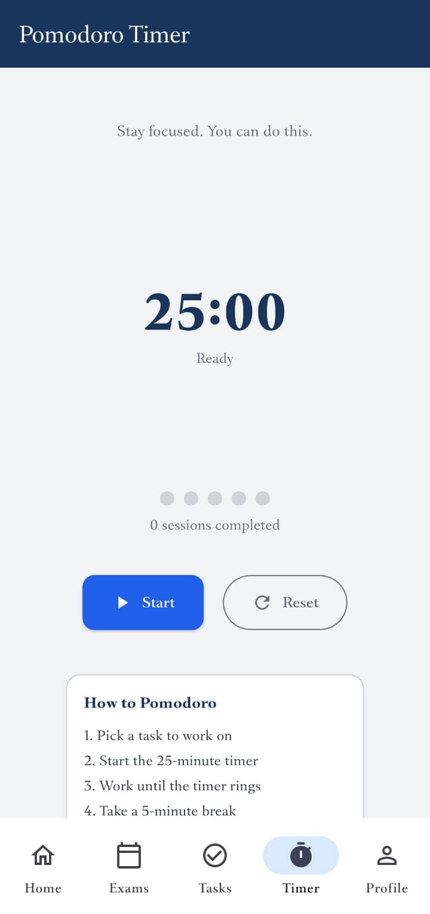

# StudyMate AI

StudyMate AI is a Flutter app for keeping study plans, deadlines, daily tasks, and focus sessions in one place. It is built to make the next step feel manageable, even when the whole semester does not.

## Screenshots

<table>
  <tr>
    <td align="center" width="33%"></td>
    <td align="center" width="33%"></td>
    <td align="center" width="33%"></td>
  </tr>
  <tr>
    <td align="center"><strong>Daily overview</strong> Exams, tasks, sessions, and modules at a glance.</td>
    <td align="center"><strong>StudyMate AI</strong> The app launch screen.</td>
    <td align="center"><strong>Focus timer</strong> A simple Pomodoro session with a reset when focus takes a coffee break.</td>
  </tr>
</table>

## What it can do

- Sign up and log in with Firebase Authentication.
- Track exams and countdowns.
- Generate study plans with the Google Gemini API.
- Organize daily tasks and monitor progress on the dashboard.
- Run Pomodoro focus sessions.
- Manage a personal profile.

## Tech stack

- Flutter and Dart
- Firebase Authentication
- Cloud Firestore
- Google Gemini API

## Run locally

1. Install the Flutter SDK and configure an emulator or connected device.
2. Clone this repository and run `flutter pub get` from the project directory.
3. Add the Firebase configuration files for your own Firebase project and configure the Gemini API key as expected by the app.
4. Run `flutter run`.

The screenshots above are captured from the app and lightly cropped to keep the interface in focus.
