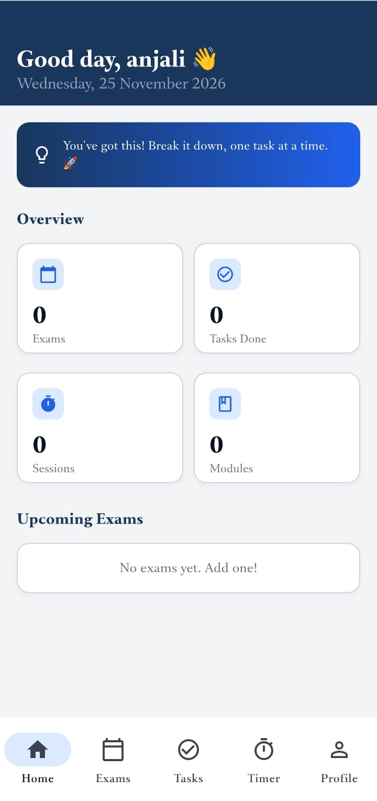
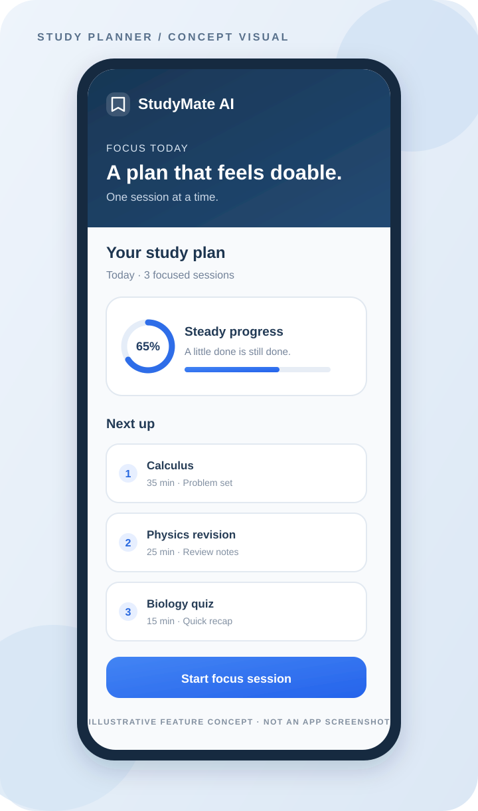
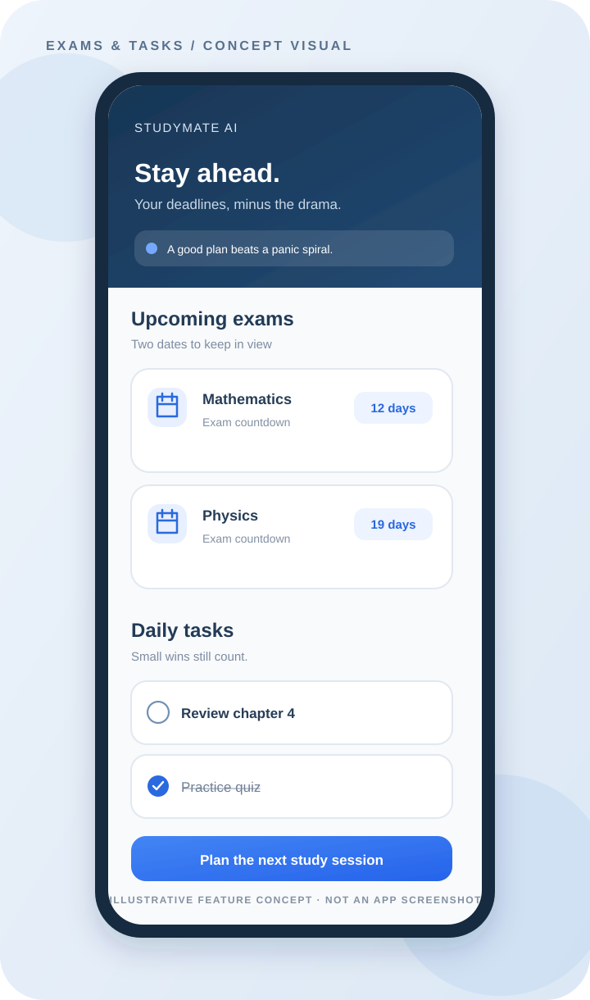

# StudyMate AI

StudyMate AI is a Flutter app for keeping study plans, deadlines, daily tasks, and focus sessions in one place. It is built to make the next step feel manageable, even when the whole semester does not.

## Screenshots

<table>
  <tr>
    <td align="center" width="50%"></td>
    <td align="center" width="50%"></td>
  </tr>
  <tr>
    <td align="center"><strong>Daily overview</strong> Exams, tasks, focus sessions, and modules in one view.</td>
    <td align="center"><strong>Pomodoro focus</strong> A 25-minute sprint, with a reset button for when life happens.</td>
  </tr>
  <tr>
    <td align="center" colspan="2"> <strong>StudyMate AI launch screen</strong></td>
  </tr>
</table>

## Feature concept visuals

These original vector mockups visualize the study-planning and exam/task flows described below. They are illustrative concepts, not screenshots of shipped app screens.

<table>
  <tr>
    <td align="center" width="50%"></td>
    <td align="center" width="50%"></td>
  </tr>
  <tr>
    <td align="center"><strong>Study planning</strong> Study sessions and progress at a glance.</td>
    <td align="center"><strong>Exams and tasks</strong> Countdowns and small daily wins in one place.</td>
  </tr>
</table>

## Built with

  
  
  

## What it can do

- Sign up and log in with Firebase Authentication.
- Track exams and countdowns.
- Generate study plans with the Google Gemini API.
- Organize daily tasks and monitor progress on the dashboard.
- Run Pomodoro focus sessions.
- Manage a personal profile.

## Tech stack

- Flutter and Dart
- Firebase Authentication
- Cloud Firestore
- Google Gemini API

## Run locally

1. Install the Flutter SDK and configure an emulator or connected device.
2. Clone this repository and run `flutter pub get` from the project directory.
3. Add the Firebase configuration files for your own Firebase project and configure the Gemini API key as expected by the app.
4. Run `flutter run`.

The images in **Screenshots** are genuine app captures, lightly trimmed around the device status bar. The feature visuals above are illustrative concepts.
